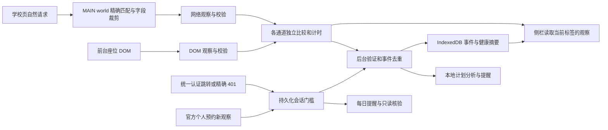

# 2.2 实时监听架构

网络身份使用 `roomId + devId + 座位编号`。对开放时间、原始状态字段、坐标和预约时段进行比较。DOM 按当前区域的编号比较类名、`title`、位置与可见时刻。响应数组与类名重排会归一化。观察时间独立记录，两个通道分别判定和计数。DOM 指纹与原始 `title` 留在页面内存。

| 观察状态 | 含义 |
| --- | --- |
| `SOURCE_UNAVAILABLE` | 本路由暂无有效观察 |
| `BASELINE` | 本路由首份有效数据，作为比较起点 |
| `CHANGED` | 新观察的实际字段与上次不同，附变更类型 |
| `UNCHANGED` | 取得新观察，比较字段相同 |
| `UNKNOWN` | 结构检查失败、证据不完整或字段语义待核验 |
| `STALE` | 上次有效观察超过两分钟 |
| `SESSION_LOST` | 认证中断待人工处理并复核个人预约 |
| `STOPPED` | 页面销毁、监听停止或到达观察上限 |

网络的座位增减或坐标变化归为 `SEAT_CHANGED`，开放时段变化或所观察的时段集合变化归为 `TIME_CHANGED`。同一时间对的记录数增减分别归为 `RECORD_ADDED` 或 `RECORD_REMOVED`，座位原始状态或同一时段的原始记录状态变化归为 `STATUS_CHANGED`。一次变化可带多个类型。当前记录缺少稳定的预约身份时，时段变化可能同时产生增加和移除分类。该组合只说明观察内容变化。DOM 仅报告座位展示与可见时间变化。

缓存重读、重复捕获和旧响应不生成新的变化。超过两分钟时触发一次本地状态更新。路由切换和从浏览器返回缓存恢复后重新建立基线。每个通道在同一观察范围最多接受 10,000 次有效观察。标签页隐藏时断开 DOM 观察，页面本身产生的网络响应仍可被动捕获。没有定时网络读取。每日辅助导航和用户操作仍通过普通标签页。

后台仅接受当前扩展的学校顶层座位页观察，检查路由与时间后保存结构化摘要和事件。事件可按日期、座位或任务筛选。最新有效观察的摘要只包含时间、来源、路由与座位数。持久化的摘要用于回顾，运行健康仍使用当前页面的网络和 DOM 证据。扩展关闭期间的数据为空缺。[运行健康与恢复](runtime-health-guide.md)

任务配置、阶段领取记录与认证中断门槛保存在 IndexedDB。后台重建未来闹钟。每日任务的阶段键包含任务、日期、座位、时段和阶段，读租约与一次性导航及提醒分别记账。页面事件只在原时间窗内触发有限复核。认证中断后，新的结构合格的官方个人预约观察可解除门槛，随后以新的座位响应建立当前基线。

电子阅览室的 152 个座位约束来自历史 Phase 3 脱敏快照，用于证据回归。当前页面观察以路由、区域和唯一编号为校验条件，允许不同座位数。开放字段与预约记录未证明目标日期的时段覆盖完整时，空档分析保持 `NEEDS_REVIEW`。学校 WebSocket 或 SSE 尚待核验。[Chrome Worker 生命周期](https://developer.chrome.com/docs/extensions/develop/concepts/service-workers/lifecycle) · [Chrome Alarms](https://developer.chrome.com/docs/extensions/reference/api/alarms)
