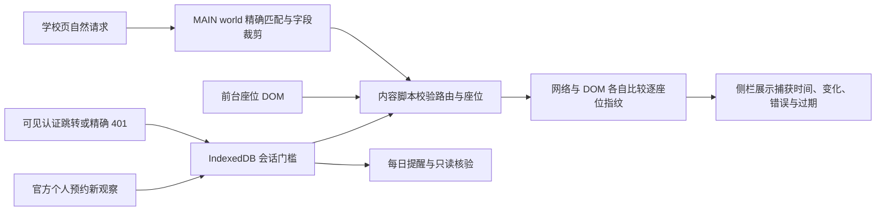

# 2.1 实时监听架构

网络身份使用 `roomId + devId + 座位编号`。比较原始开放时间、状态字段、坐标和排序后的预约区间。DOM 在当前座位路由内按编号比较类名、`title`、位置与可见时刻。排序使数组和类名重排保持同一指纹；观察时间独立记录。网络与 DOM 分开判定和计数，侧栏同时展示全区摘要与所选座位最近变化。DOM 指纹与原始 `title` 留在内存，向界面传递变化身份和时间。

| 观察状态 | 含义 |
| --- | --- |
| `SOURCE_UNAVAILABLE` | 本路由暂无有效观察 |
| `BASELINE` | 本路由首份有效数据，作为比较起点 |
| `CHANGED` | 新观察的实际字段不同，计入变化 |
| `UNCHANGED` | 取得新观察，业务字段相同 |
| `UNKNOWN` | 响应或页面结构校验失败、证据不完整或字段语义待核验 |
| `STALE` | 上次有效观察超过两分钟 |
| `SESSION_LOST` | 认证中断待人工处理并复核个人预约 |
| `STOPPED` | 页面销毁、监听停止或到达观察上限 |

重复捕获、旧观察和没有新数据的状态读取均不会生成变化。两分钟到期只触发一次侧栏本地重读。路由切换和 BFCache 恢复后重新建立基线。每个通道每个路由范围最多接受 10,000 次有效观察，标签页隐藏时暂停 DOM 观察。没有定时网络读取；2.0 的每日辅助导航和用户打开页面仍通过普通标签页。

任务配置、阶段领取记录与认证中断门槛保存在 IndexedDB。Worker 重建未来闹钟。阶段键包含任务、日期、座位、时段和阶段；读租约与一次性导航及提醒分别记账。页面事件只在原时间窗内触发有限复核。认证中断后保留配置，只有新的、结构合格的官方个人预约观察能解除门槛，随后新座位响应建立基线。上次复核记录不证明当前登录有效。

电子阅览室的 152 个座位约束来自原 Phase 3 脱敏快照和原有 `parseVisibleSeats` 验证，用于历史证据回归。2.1 的普通页面观察按路由、区域和唯一编号校验，允许不同座位数。相同数量也不能证明时间覆盖完整。学校 WebSocket 或 SSE 仍待证据核验。[Chrome Worker 生命周期](https://developer.chrome.com/docs/extensions/develop/concepts/service-workers/lifecycle) · [Chrome Alarms](https://developer.chrome.com/docs/extensions/reference/api/alarms)
