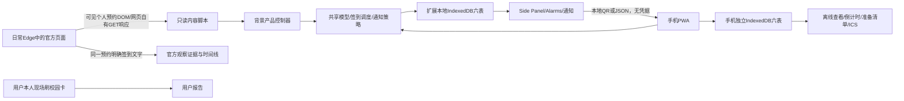

# DLMU Library Assistant 1.0.0 架构

正式源码位置为 D:/文档/deepseek-harness/default-workspace/library-seat-assistant/library-seat-assistant。本次交付为本地助手软件发布，不包含公网托管、原生手机App或学校接口授权。

共享TypeScript位于 src/core 和 src/storage/product-db.ts，不强行拆分Monorepo。两端调用相同时间解析、Asia/Shanghai日期核验、用户提醒计算、签到状态机、交接校验、ICS及NotificationManager。官方签到提前时间无经核验配置，因此officialOpensAt=null；用户20分钟偏好不会冒充校方规则。跨日时间保留实际结束日期，所有时间均需显式时区，拒绝非法日期和无效偏移。

预约模型保留编号身份的SHA256、日期、楼层/区域名、座位、起止、来源、观察时间；无法从个人页面证实的floorId/roomId/seatId为null。完整原始编号仅在解析时参与联合身份计算，不进入二维码。原152个座位及坐标、研究状态解析和模拟任务保留，独立于签到准备。

数据库表为reservations、checkinTasks、stateEvents、snapshots、settings、notificationHistory。事务串行保护多标签提醒去重；快照按身份、时间、状态追加，不覆盖原始观察。默认保留历史，不自动清理；结束任务标为EXPIRED。备份包含六表、偏好和完整性摘要；导入的官方主张一律重新核验。本地已有官方观察不会被QR/备份覆盖。

日常工作不启动Playwright、不复制普通Edge配置、不读取凭据。旧研究脚本在仓库保留但不属于产品启动链路。工作树与旧快照已在C盘work备份，Phase6/7标签不变。发布使用独立分支和dlmu-assistant-v1.0.0标签。
